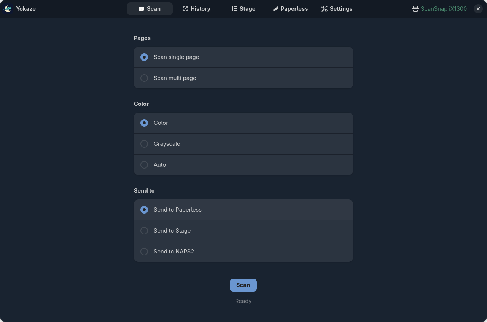
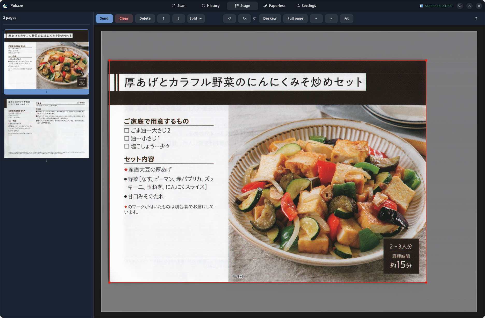
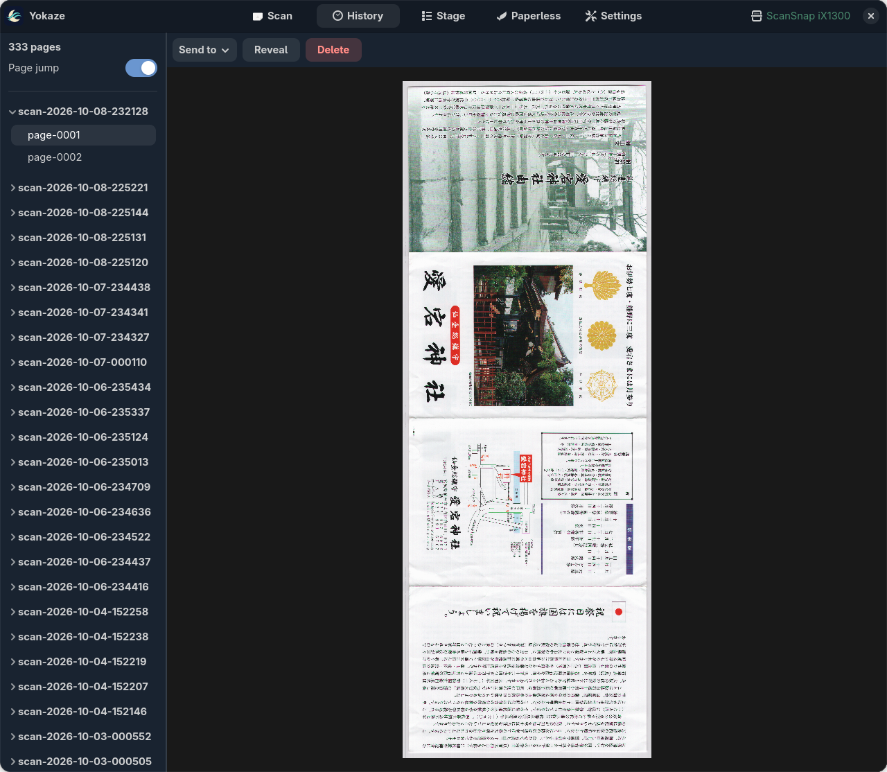
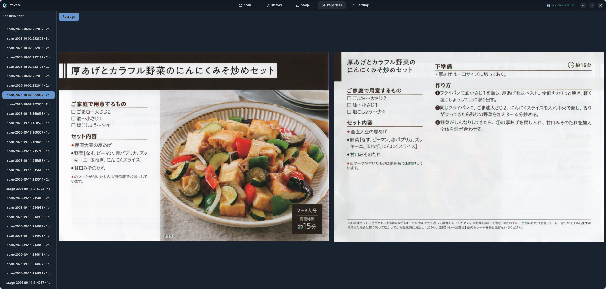

<div align="center">

# Yokaze (夜風)

**A complete scanner-to-PDF workflow for Linux — capture, clean up, assemble, and deliver.**

[](http://www.sane-project.org/)
[](https://www.python.org/)
[](https://www.gtk.org/)
[](https://gnome.pages.gitlab.gnome.org/libadwaita/)
[](https://docs.paperless-ngx.com/)
[](LICENSE)

Press the scanner button. Get a polished PDF.

</div>



Yokaze turns a SANE scanner into a focused document workstation. It handles the
whole path from physical paper to a clean PDF: duplex capture, blank removal,
orientation, deskew, crop, page assembly, review, and delivery to
[Paperless-ngx](https://docs.paperless-ngx.com/), NAPS2, or a folder.

It is built around standard SANE tools and is intended to grow into a
scanner-agnostic workflow. Today, automatic discovery, paper sensors, source
selection, and udev setup are tailored to Fujitsu ScanSnap devices. It is tested
with a ScanSnap iX1300; another SANE device can be selected explicitly, but may
need backend-specific adaptation.

## The workflow

1. **Choose once** — select a scanner, Paperless server, paper-length mode, and
   archive location in Settings.
2. **Capture anything** — scan one page, a feeder batch, or keep adding batches
   to one document. The in-app button and the scanner’s hardware button share
   the same flow.
3. **Let Yokaze finish it** — blank backs are removed; pages are oriented,
   deskewed, cropped, color-adjusted, and assembled in the background.
4. **Send directly or use Stage** — deliver immediately, or collect pages from
   several scans and edit the document before sending.
5. **Come back later** — History preserves the raw capture. Reprocess it with
   newer cleanup logic, or rebuild a delivered Paperless document and replace it.

## Features

### Capture without babysitting

- **Hardware-button or in-app scanning** — one capture path, whichever button
  is more convenient.
- **Single-page and open-ended multi-page documents** — scan another batch,
  change color or destination if needed, then press Finish.
- **Duplex feeder and front/card slot detection** — Yokaze uses the loaded input
  and refuses ambiguous “both loaded” states.
- **Normal and long paper** — fixed A4 capture or experimental automatic
  length detection for ADF sheets up to the scanner/backend limit.
- **Background enhancement** — the scanner is released for the next batch while
  previous pages are processed.
- **Color, grayscale, or per-page auto color** — keep mixed documents compact
  without flattening everything to monochrome.
- **True raw archive for every GUI scan** — delivery edits never destroy the
  original capture.

### Automatic document finishing

Every page passes through one shared pipeline:

```text
SANE capture → blank detection → rough crop → orientation → deskew
             → paper crop → color and tone → PDF → delivery
```

- Drops empty duplex backs.
- Corrects page orientation with confidence-aware OCR.
- Deskews before the final paper crop.
- Detects the sheet instead of trusting a hard driver crop.
- Applies consistent color and tone at delivery time.
- Uses the same processing path in the desktop app and headless button flow.

### Stage: build the document you actually want



Stage is a durable page tray between scanning and delivery:

- Combine pages from multiple scans, History archives, and previous Paperless
  deliveries.
- Multi-select, drag or nudge to reorder, delete pages, and undo deletion.
- Adjust the crop or restore the full page.
- Rotate by quarter turns and fine-tune deskew.
- Split one scan into two or many pages with draggable horizontal or vertical
  guides.
- Send the whole tray, or send a selected subset while keeping the rest.
- Quit or reload without losing the staged document.

### History: raw scans stay useful



- Browse every archived scan and page.
- Reveal an archive in the file manager or delete it from Yokaze.
- Send the recorded historical result again.
- Reprocess the raw scan through the current finishing pipeline.
- Send an archive directly to Paperless or add it to Stage for editing and
  mixing with other scans.

### Paperless-ngx, including “clawback”



Yokaze records the page composition of successful Paperless uploads. The
Paperless tab can **Restage** a delivered document from its original archives,
including its crop and rotation overlays. Edit it, combine it with other pages,
then Send to replace the old remote document with a corrected PDF.

This makes a premature upload recoverable without finding and rescanning the
paper.

### Delivery choices

- **Paperless-ngx API** — direct authenticated upload plus local delivery history.
- **NAPS2** — hand the finished PDF to NAPS2 for its own save/export workflow.
- **Folder** — headless delivery to `FOLDER_DIR` for another watcher or archive.

## Hardware support

Yokaze uses `scanimage` and SANE rather than a proprietary scanner SDK.

| Capability | Current status |
|---|---|
| Fujitsu ScanSnap through SANE’s `fujitsu` backend | Supported; tested on iX1300 |
| Explicitly configured SANE device ID | Available; backend options must match current capture assumptions |
| Other SANE scanners | Project direction; discovery, sources, sensors, geometry, and button setup still need profiles |

The current ScanSnap profile expects duplex ADF/card sources, `page-loaded` and
`card-loaded` sensors, and several `fujitsu` backend options. Contributions and
hardware reports are welcome.

## Installation

Yokaze is currently developed and packaged on Arch Linux.

### From source

Install the system dependencies listed below, clone the repository, then:

```bash
just check
just install
```

`just install` installs the application launcher, Python entry points, user
service, and ScanSnap udev rule. It asks for `sudo` only when installing the
system udev rule.

Open **Yokaze** from the application menu and visit **Settings** to:

- select or refresh the scanner;
- choose automatic-length or fixed-A4 capture;
- set background enhancement workers;
- choose the History archives folder;
- enter and test Paperless-ngx credentials.

### Requirements

- `just`, SANE (`scanimage`), Tesseract, `libnotify`, and XDG utilities
- Python 3.11+, PyGObject, GTK 4, and libadwaita
- OpenCV and Pillow
- NAPS2 only when using NAPS2 delivery or its optional deskew engine

On Arch Linux, the main packages are:

```bash
sudo pacman -S just sane tesseract libnotify xdg-utils \
  python python-gobject gtk4 libadwaita python-opencv python-pillow
```

Run `just check` at any time for a machine-readable dependency check.

## Usage

### Desktop

```bash
just gui
./yokaze --tab history
```

The five tabs form the normal usage flow:

- **Scan** — choose page mode, color, and Paperless / Stage / NAPS2.
- **History** — revisit, resend, reprocess, or stage raw archives.
- **Stage** — assemble and correct pages before sending.
- **Paperless** — browse local delivery records and Restage an upload.
- **Settings** — scanner, paper, performance, archives, and Paperless setup.

### Hardware button and headless mode

```bash
yokaze-button       # normally managed by the user service
yokaze-scan         # capture and deliver without opening the app
```

When the app is open, the hardware button triggers its current Scan choices.
When it is closed, the button service runs a headless single-document scan:
Paperless is preferred when configured; otherwise `FOLDER_DIR` is used.

## Data and privacy

- Raw History archives stay local under `~/.local/share/yokaze/archives` by
  default, or in the folder selected in Settings.
- The Stage tray and Paperless delivery index are local application data.
- Paperless credentials are stored in
  `~/.config/yokaze/scanner.conf`.
- Yokaze sends document data only to the delivery target you choose.

## License

Yokaze is available under the [MIT License](LICENSE).
